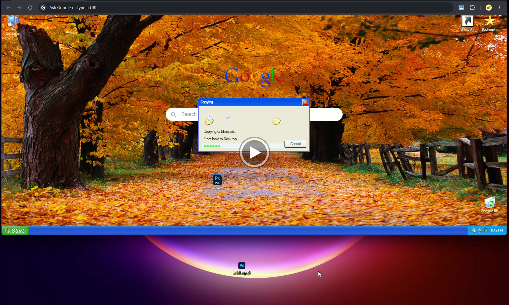
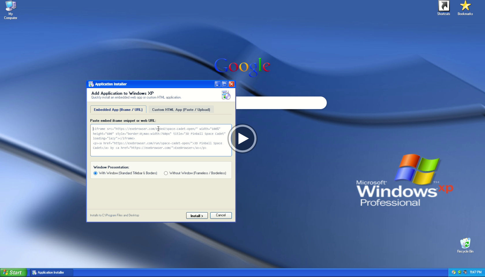
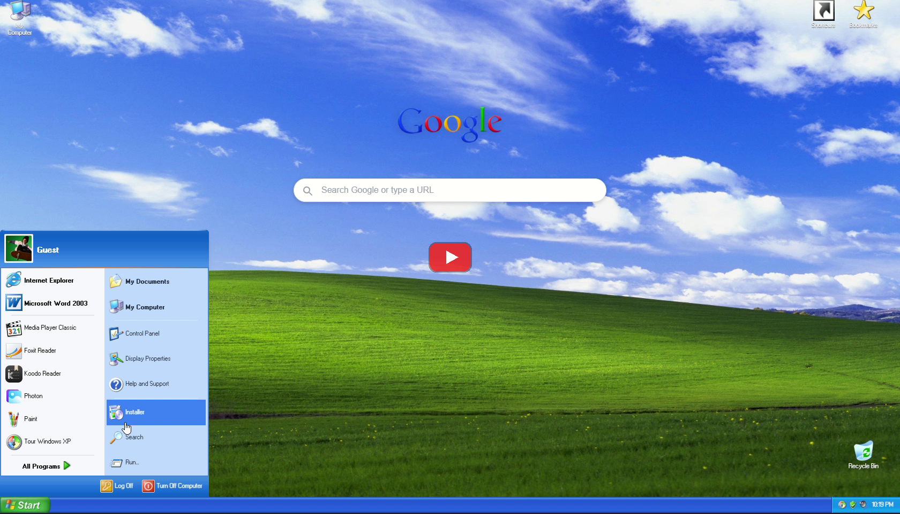
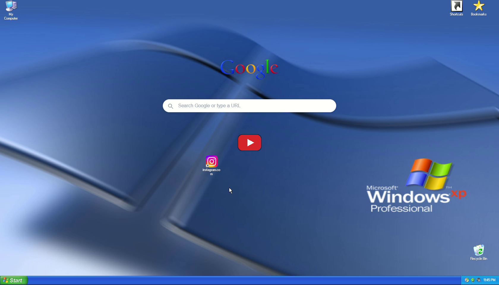
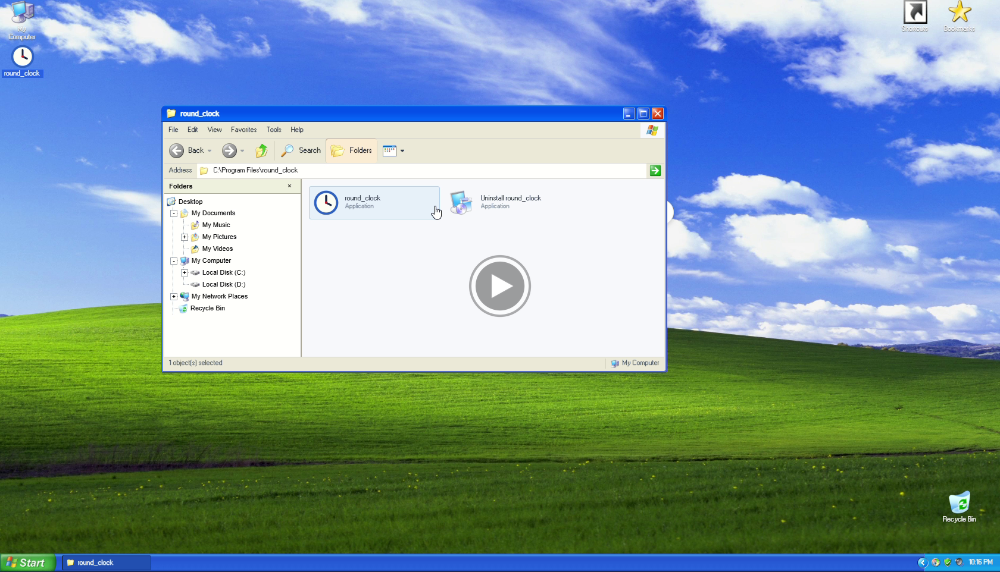
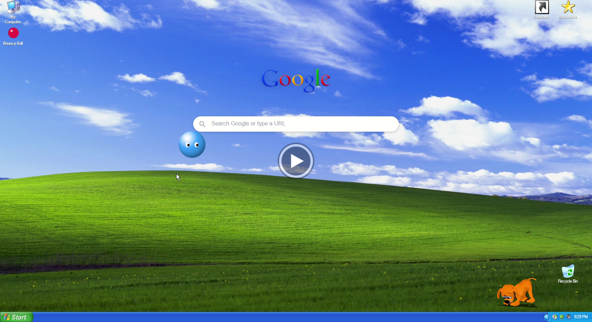

# Windows XP Simulator - Source Code & Architecture Repository

Official source code staging repository for **[Windows XP Simulator](https://xpsimulator.com)**.

---

## Engineering Announcement

We are actively implementing core architectural enhancements, optimizations, and performance improvements across the Windows XP Simulator platform. The source code repository will be published once these refinements are finalized to our quality standards.

During this cycle, active production builds are compiled and deployed continuously at **[xpsimulator.com](https://xpsimulator.com)**.

---

## Video Tutorials & Guides

Click any tutorial thumbnail below to watch the high-definition video demonstration:

### 1. How to Import Files into the Simulation
*Drag and drop local files, pictures, music, and archives directly into the virtual Windows XP filesystem.*

---

### 2. How to Add Web Embedded Apps
*Embed live web applications, dashboards, and online games directly inside authentic Luna window frames.*

---

### 3. How to Add HTML Apps & Widgets (with Clock UI)
*Deploy autonomous HTML5 widgets with desktop docking, transparency, and background execution.*

---

### 4. How to Add Link Apps and Shortcuts
*Create desktop icons and Start Menu shortcuts linking directly to modern cloud destinations.*

---

### 5. How to Uninstall an Application
*Cleanly uninstall registered applications, desktop shortcuts, tray icons, and startup hooks.*

---

## Interactive Application Demo: Bouncy Ball

Experience real-time physics simulation running across the Windows XP desktop environment. Balls collide with windows, the Google search bar, taskbar, and each other.

  

---

## Website & Extension Showcase Gallery

### 1. Classic Pinball Game & Windows Media Player

*Authentic 3D Pinball Space Cadet with classic audio synthesis and Windows Media Player with dynamic Headspace skin.*

---

### 2. Wallpapers & Headspace Skins

*Dynamic bliss wallpapers, customized system themes, and real-time Headspace skin transformations.*

---

### 3. Classic Google Search

*Vintage Google Search interface running inside Internet Explorer with authentic period styling.*

---

### 4. The Classic Google Search Index

*Full-fidelity retro Google search index and live web directory navigation.*

---

### 5. Classic YouTube Experience

*Authentic Internet Explorer 6 window running YouTube retro video playback with native controls and sound.*

---

### 6. Multiple Apps in the Start Menu

*Multi-application productivity suite accessible from the authentic two-column Windows XP Start Menu.*

---

### 7. Lock Screen & Password Protection

*Authentic Windows XP welcome and lock screen with multi-user profiles and password validation.*

---

### 8. Sticky Notes

*Desktop sticky notes and workspace productivity tools with automatic state persistence.*

---

## Support & Contributions

Encourage us to keep enhancing the experience and sharpening it to the edge. Your support directly funds server infrastructure, continuous simulator updates, and new classic software additions.

  

---

## Ecosystem Portals & Documentation

- **Live Simulation**: [https://xpsimulator.com](https://xpsimulator.com)
- **Extension Manual & Developer Portal**: [https://extension.xpsimulator.com](https://extension.xpsimulator.com)
- **Official Documentation Suite**: [https://docs.xpsimulator.com](https://docs.xpsimulator.com)
- **Companion Extension Repository**: [https://github.com/elmehdi-khalda/xpsimulator-newtab](https://github.com/elmehdi-khalda/xpsimulator-newtab)

---

## Author & Maintainer

Created and maintained by **EL MEHDI KHALDA**.

All source materials, runtime assets, and virtual subsystems are developed under clean-room engineering practices and applicable fair use standards.
